# Rustacer

A native Windows 10/11 system optimizer, monitor and driver updater written in Rust.
It ships as a single portable `.exe` built with [egui/eframe](https://github.com/emilk/egui), so there is no WebView and no Electron.

| Dashboard | Driver updates |
|---|---|
| 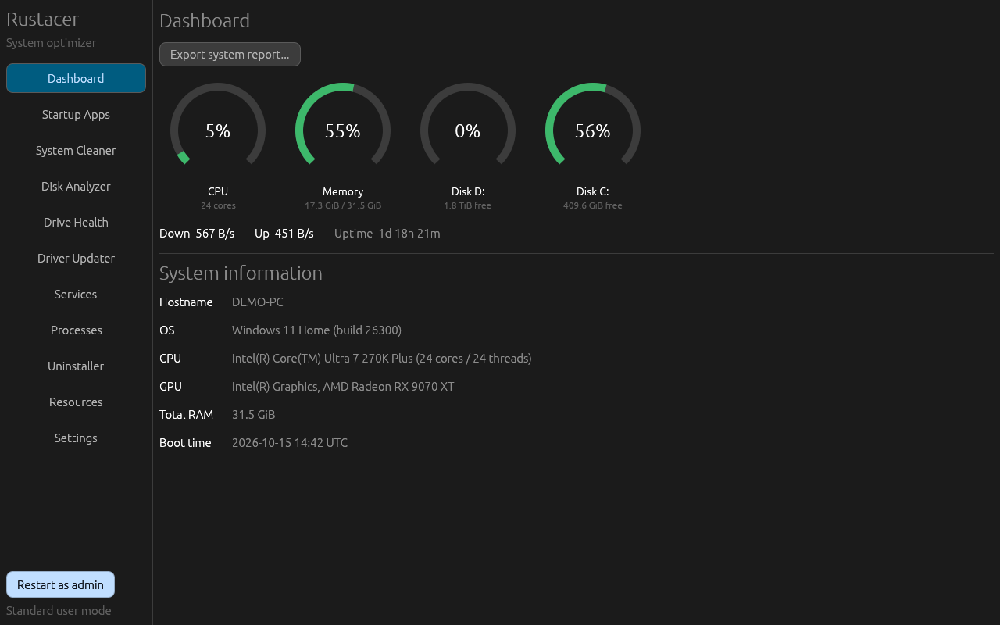 | 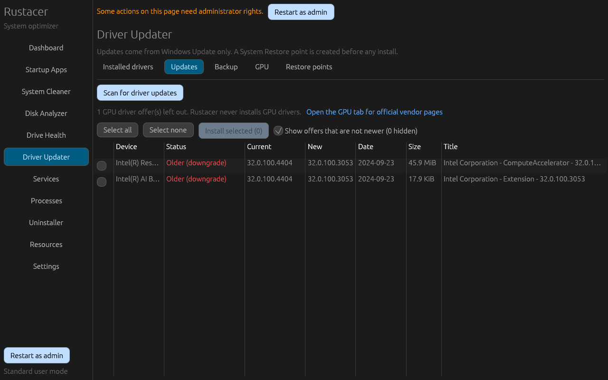 |
| **System Cleaner** | **Resources (Dracula theme)** |
| 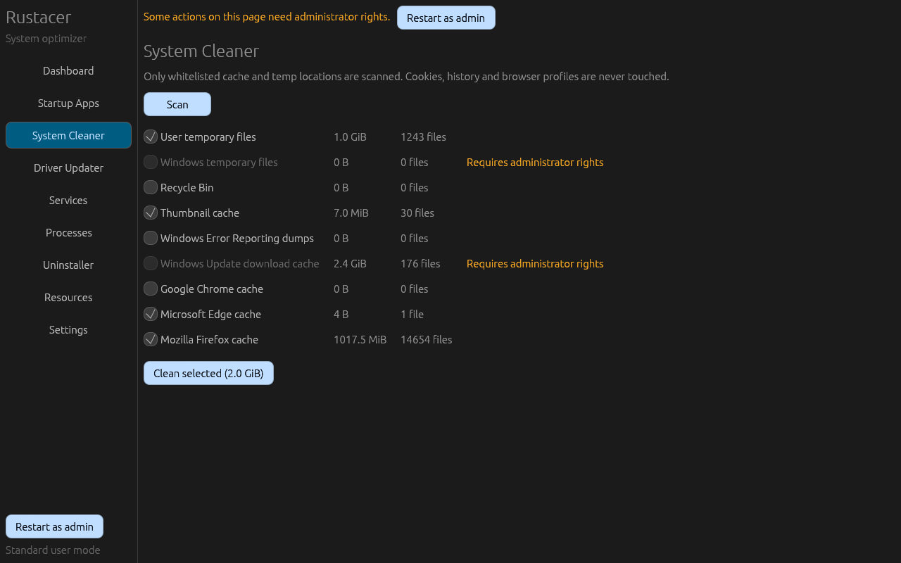 | 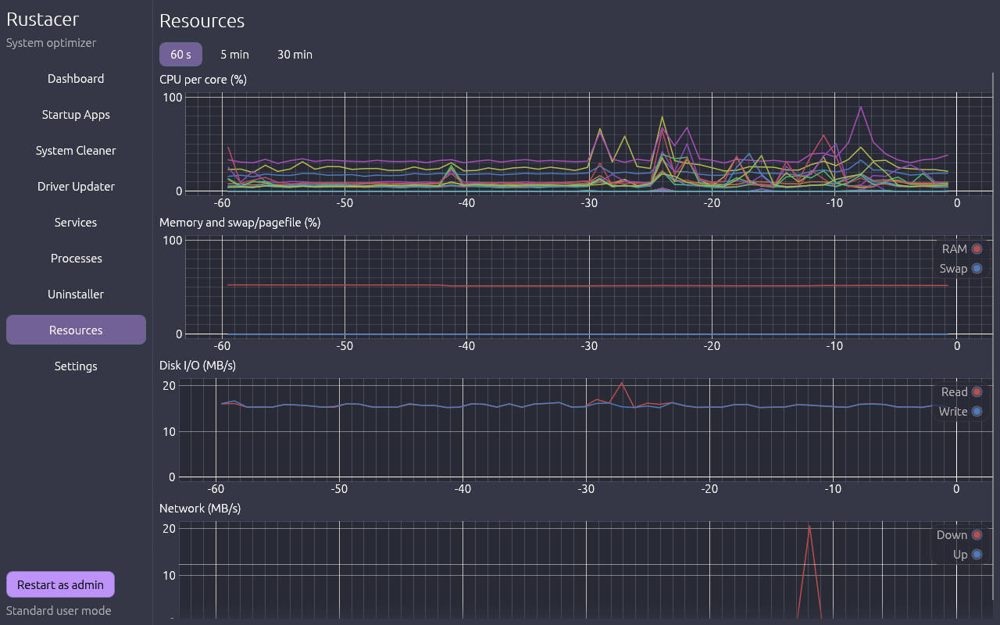 |
| **Installed drivers** | **GPU drivers** |
| 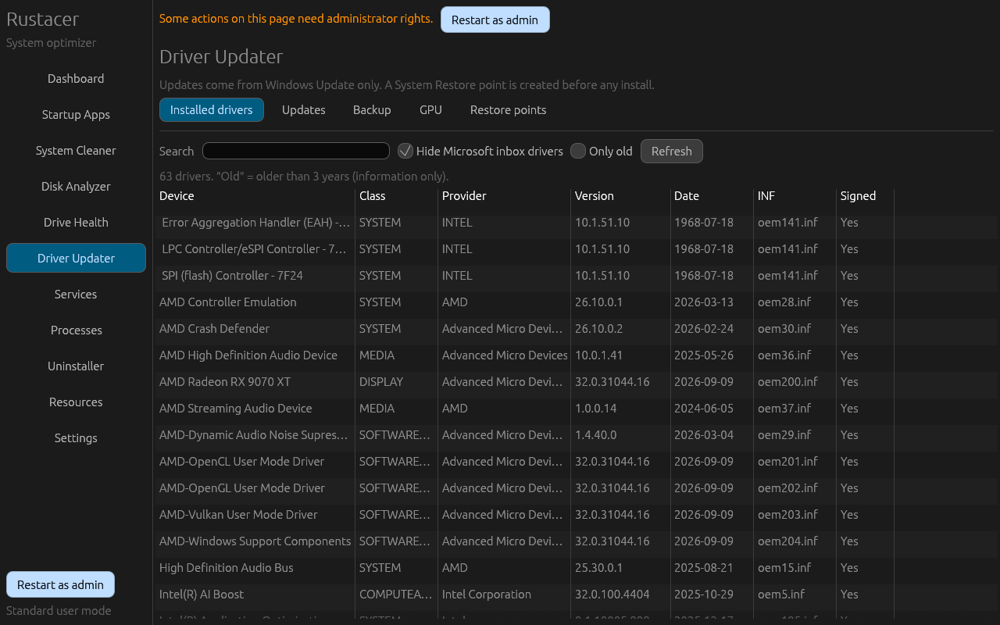 | 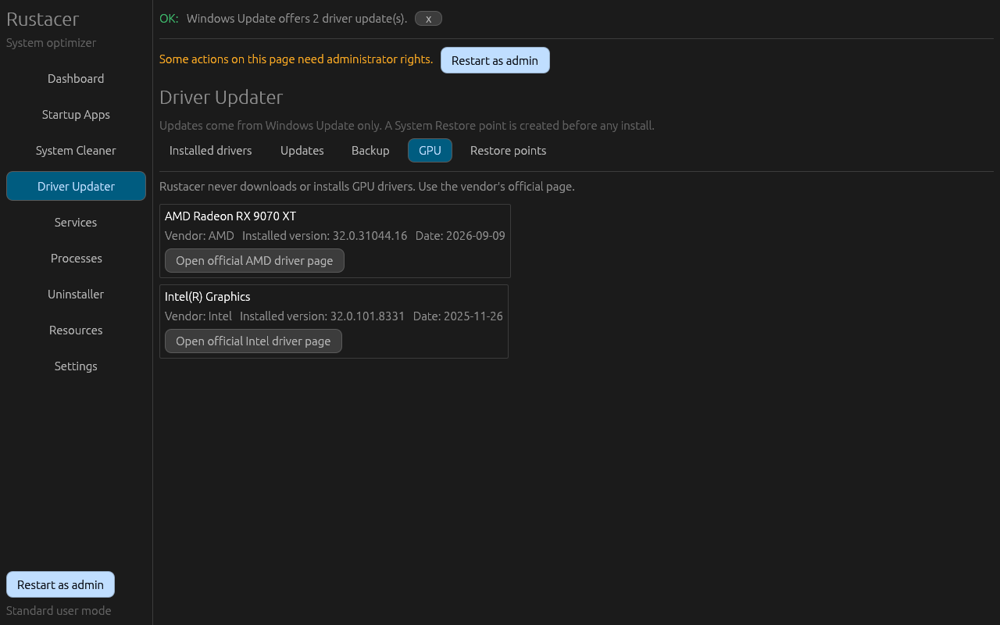 |
| **Services** | **Settings (Nord theme)** |
| 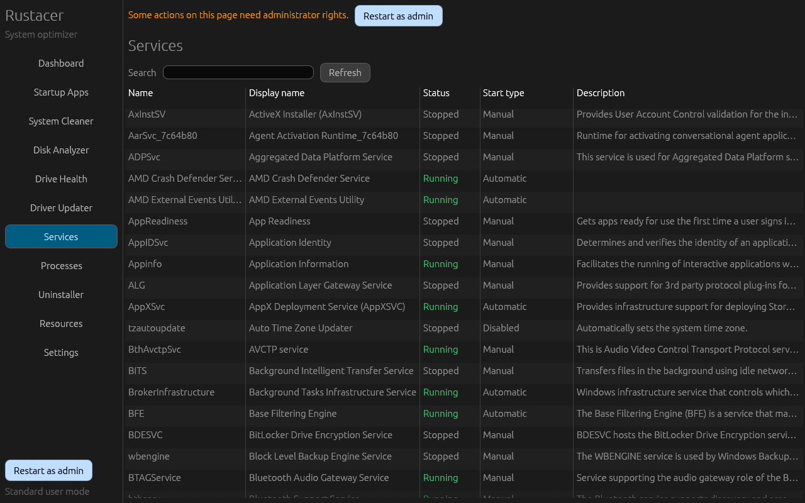 | 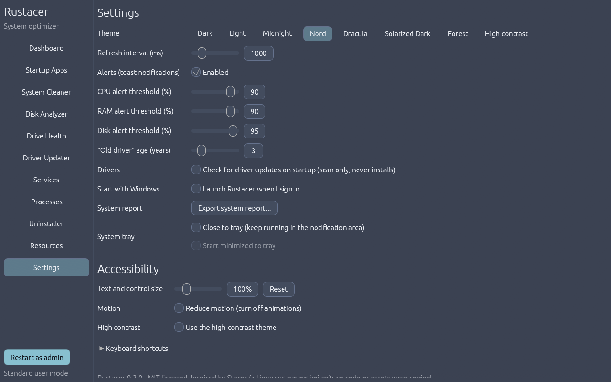 |
| **Disk Analyzer** | **Drive Health** |
| 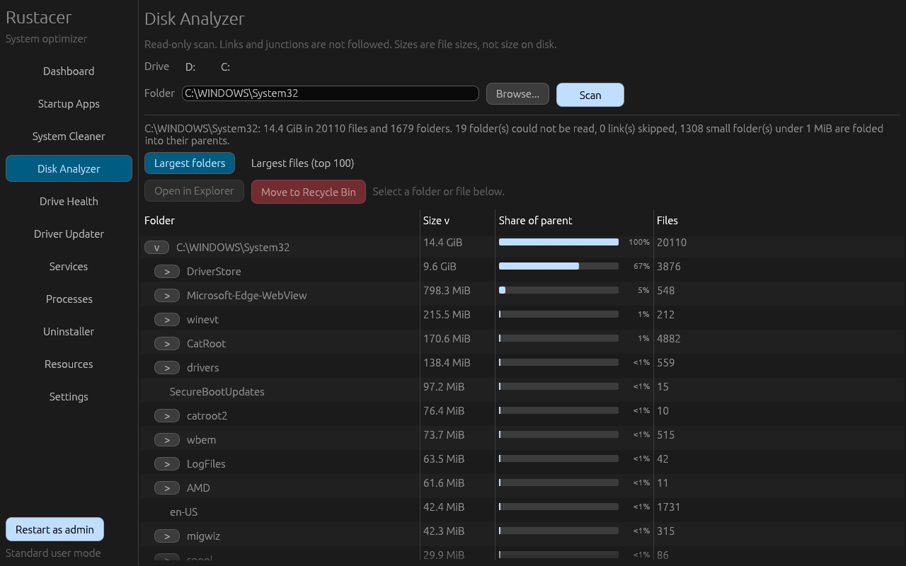 | 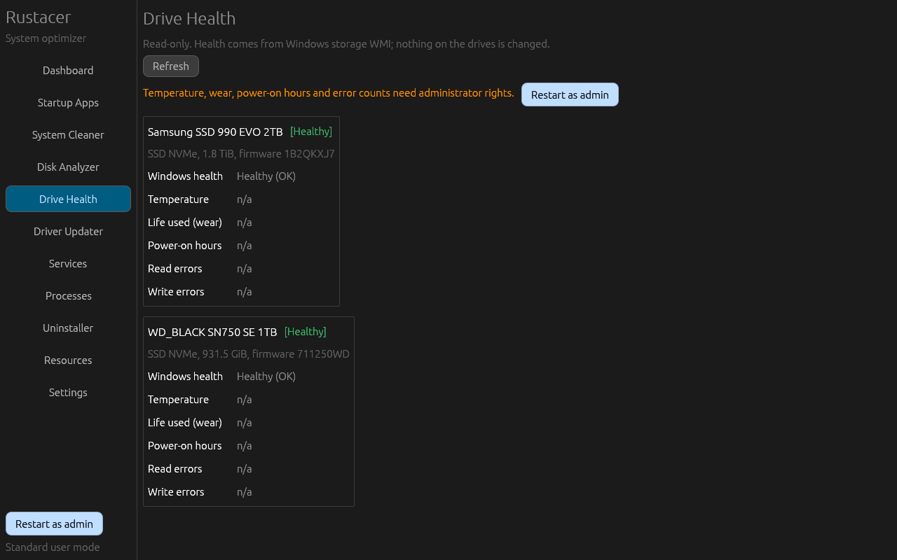 |
| **Network connections** | |
| 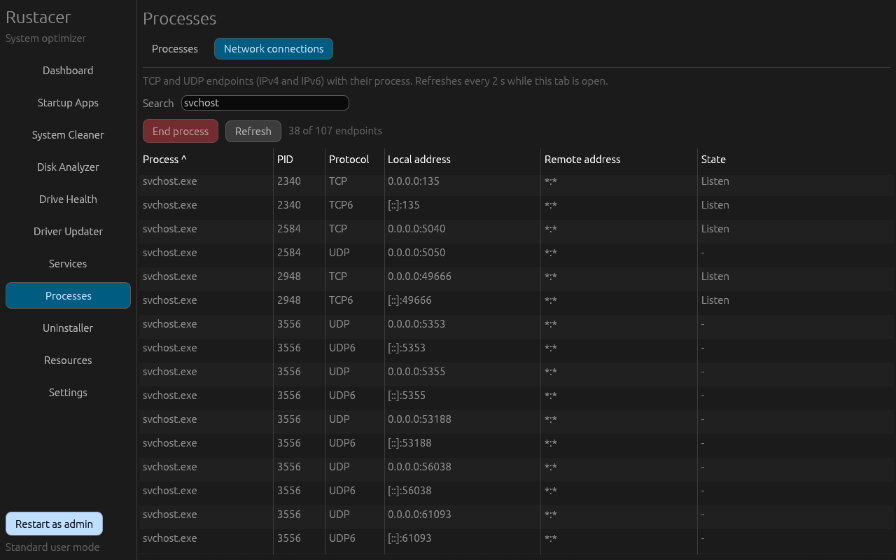 | |

The screenshots are generated by the app itself with `rustacer.exe --screenshots docs/screenshots`. The PC name is redacted, the Disk Analyzer image scans `C:\Windows\System32`, and the network image shows only Windows service hosts, so no user name, personal files or browsing appear. Drive Health is shown without admin rights, so its counters read n/a.

## Inspired by Stacer

Rustacer is inspired by [Stacer](https://github.com/oguzhaninan/stacer), a Linux system optimizer written in Qt/C++.
It reimplements similar ideas for Windows from scratch. No Stacer code, icons or assets are used.
Stacer is GPL-3.0; Rustacer is MIT.

## Features

| Page | What it does |
|------|--------------|
| Dashboard | Live CPU, RAM and per-drive gauges, network up/down speed, uptime, and OS / CPU / GPU / RAM / hostname / boot-time info. **Quick actions** start a junk scan, an app update check, a driver update search or a scan of the Windows drive (all read-only; installing or deleting still asks on its own page) and open **Export system report...**. **Startup** shows how many startup apps are enabled, and as admin the last boot time and the app that slowed boot most. **Network** shows the active adapter (Wi-Fi or Ethernet), link speed, local address and open connections, refreshed every 10 s while the dashboard is open |
| Startup Apps | Lists Run and RunOnce entries (HKCU, HKLM and the 32-bit HKLM view), the user and all-users Startup folders, and logon tasks from Task Scheduler (outside `\Microsoft`). Run and Startup-folder entries are disabled through `StartupApproved`, the same way Task Manager does it, so you can turn them back on. Disabled RunOnce entries are parked under `HKCU\Software\Rustacer\DisabledRunOnce`. You can also add a per-user entry (program and arguments) or delete an entry. The **Boot performance** tab (admin) shows boot-time history and the apps Windows says slowed boot, and links each one to its startup entry |
| System Cleaner | Scans first and shows the size and file count per category. You tick categories, confirm, and it deletes. Categories: user `%TEMP%`, `C:\Windows\Temp` (admin), the Recycle Bin, the thumbnail and icon cache, Windows Error Reporting files, the Windows Update download cache (admin; `wuauserv` is stopped and restarted), and the Chrome, Edge and Firefox cache folders only. Locked files are skipped and listed |
| Disk Analyzer | Pick a drive or folder and scan it on a worker thread with progress and Cancel. Shows the largest folders as a sortable tree with size bars, and the 100 largest files. Reparse points (junctions, symlinks) are skipped and unreadable folders are counted. **Open in Explorer** and **Move to Recycle Bin** (confirmed; see Safety) |
| Drive Health | Read-only health of every physical drive from Windows storage WMI: Healthy / Warning / Unhealthy written out in text, media and bus type, and temperature, wear, power-on hours and error counts (admin) |
| Driver Updater | Lists installed drivers with a search box, a toggle to hide Microsoft inbox drivers and an "old driver" flag. Also scans Windows Update for non-GPU drivers, installs the ones you select after creating a restore point, backs up drivers with `pnputil`, links to official GPU vendor pages, and lists System Restore points so you can keep or delete each one |
| Services | Lists every Win32 service. You can start, stop or restart a service and set its start type to Automatic, Automatic (Delayed), Manual or Disabled. Critical services show a warning, and services on the protected list are blocked in the core library |
| Processes | Sortable table with search. You can end a process or a whole process tree, or open its file location. Critical system processes cannot be ended. The **Network connections** tab lists TCP and UDP endpoints (IPv4 and IPv6) with process, PID, local and remote address and TCP state, refreshed every 2 s while the tab is open; filter by process, PID or port and end the owning process through the same guard |
| Uninstaller | Apps from the HKLM, 32-bit HKLM and HKCU Uninstall keys, with duplicates removed. Runs the app's own uninstaller or its quiet uninstaller. System components and updates are hidden by default. Optionally lists winget apps and uninstalls them by winget id |
| App Updates | Admin only. Lists `winget upgrade` results (GPU driver packages are left out) and upgrades the packages you tick, one at a time, in winget's own window. If one fails, winget's own explanation of the error is shown |
| Resources | Graphs over the last 60 s, 5 min or 30 min for per-core CPU, RAM, swap/pagefile, disk read/write and network |
| Settings | 8 themes (Dark, Light, Midnight, Nord, Dracula, Solarized Dark, Forest, High contrast), accessibility options (below), refresh interval, alert thresholds for CPU, RAM and disk (shown as a Windows toast at most once every 5 minutes per alert), the "old driver" age, check for driver updates on startup, start with Windows, optional system tray mode (below), and **Export system report...** |

Sizes are shown in binary units (KiB, MiB, GiB). The UI strings come from a string table that is ready for translation; only English exists today.

## Accessibility

- **Screen readers:** Narrator and NVDA are supported through AccessKit. The dashboard gauges, which are drawn shapes, are announced with their value (for example "CPU: 6 percent").
- **Text and control size:** 75% to 200% in Settings. Ctrl+= / Ctrl+- / Ctrl+0 work anywhere and are remembered.
- **High contrast theme:** black, white and yellow, aimed at WCAG AAA text contrast. All accent buttons are tested for at least 4.5:1 contrast on every theme.
- **Reduce motion:** turns off animations and smooth scrolling.
- **Keyboard:** Tab / Shift+Tab move focus, which has a 2 px outline. Ctrl+1 to Ctrl+9 jump to the first nine pages, Ctrl+PageDown / Ctrl+PageUp cycle through all pages, F11 toggles fullscreen and Esc leaves it. The full list is under Settings > Keyboard shortcuts.
- **Small windows and large text:** tables shorten text with "…" instead of wrapping, the sidebar scrolls when it doesn't fit, and Settings scrolls.

## Window

- Tables and graphs resize with the window, including when it is maximized or fullscreen.
- Window size, position and maximized state are remembered between launches (eframe stores them in `%APPDATA%\Rustacer\data`).

## Driver updater

- **Windows Update is the only source.** Rustacer uses the Windows Update Agent COM API with the criteria `IsInstalled=0 and IsHidden=0 and Type='Driver'`. There are no third-party driver databases, no scraping and no other download URLs anywhere in the code.
- **Nothing is installed automatically.** "Check for driver updates on startup" only scans. You tick updates and confirm, and only those updates are downloaded and installed.
- **GPU drivers are never offered or installed.** Display-class updates from Windows Update are left out of the list, with a note saying how many. The install function independently refuses any GPU update even if its ID is passed in. Use the GPU tab to open the vendor's official page instead.
- **Downgrades are flagged.** Windows Update sometimes offers a driver that is the same as or older than the one installed. Each offer gets a status (Newer, Same version, Older (downgrade) or Unknown), and only newer ones are shown by default. If you show the others and select them, the confirm dialog warns you.
- **A restore point comes first.** Before every install batch, Rustacer asks Windows to create a System Restore point. If that fails, for example because System Protection is off, you are told why and must choose to cancel or continue. Windows may limit how often restore points are created.
- **Installing needs admin.** When you aren't elevated, the install is refused up front with a "Restart as admin" hint. Downloads can be cancelled; once installation starts it runs to completion. Each update's result is shown. If a reboot is required, a **Reboot now** button appears; it asks for confirmation and then restarts after 10 s (`shutdown /a` aborts).
- **Backup** runs `pnputil /export-driver * <folder>` (admin) and shows its output and the exported package count.
- **GPU drivers.** NVIDIA, AMD and Intel GPUs are detected with their installed driver version. A button opens the vendor's official driver page (nvidia.com, amd.com or intel.com). Rustacer never downloads or installs GPU drivers itself.
- Updates are matched to installed devices by every hardware and compatible ID (`Win32_PnPEntity`), falling back to the device name when it is unambiguous.
- **Restore points tab (admin).** Lists every System Restore point with its number, date, type and description. You keep a point by doing nothing; deleting one (`SRRemoveRestorePoint`) needs confirmation, and the dialog warns that it cannot be undone and points out when you are deleting the newest one.
- While a search or install is running, Rustacer will not stop `wuauserv` or clear the Windows Update cache, either from the cleaner or from the Services page.
- Drivers whose date is a placeholder (Intel uses 1968-07-18 for INF-only packages) are not flagged "old".

## Disk analyzer

- The scan is read-only. It never follows junctions or symlinks (so nothing is counted twice and the scan cannot wander off the chosen folder), counts folders it cannot read, and can be cancelled. Sizes are file sizes, not size on disk, and hard links are counted once per name.
- Folders under 1 MiB below the first level are folded into their parents so a whole-drive result stays small.
- **Move to Recycle Bin** is the only action that changes anything, and it only ever moves to the Recycle Bin (`SHFileOperationW` with `FOF_ALLOWUNDO`). It works only on a path you selected, only after a confirmation, and only on fixed local drives.
- Just before acting, the core library re-checks that:
  - the scanned folder is still a real folder (not swapped for a junction) and the path is still inside it, with no link on the way;
  - the path is not a link, a system file, an alternate data stream or a name Windows would rewrite (trailing dot or space);
  - it is not under `C:\Windows`, `C:\Program Files*`, `C:\ProgramData`, a drive root, a top-level folder of the system drive or a user profile folder (also after resolving 8.3 short names);
  - a folder contains no links and no unreadable subfolders.
- It then reads the Recycle Bin settings for the drive and refuses when Windows would delete permanently instead: the "Remove files immediately" option, the policy that turns the Recycle Bin off, or an item bigger than the bin. The shell's own prompt is also left on as a last line of defence.
- Rustacer acts on exactly the resolved path it checked. A file could still be swapped between the check and the move by another program; the window for that is milliseconds.

## Boot performance

The Boot performance tab in Startup Apps reads events 100 (boot duration) and 101 (applications that slowed boot) from `Microsoft-Windows-Diagnostics-Performance/Operational` with the Windows Event Log API, falling back to `wevtutil`. Reading that log needs administrator rights; without them the tab shows a **Restart as admin** prompt. Slow applications are matched to a startup entry by executable name, so you can jump straight to the entry and disable it.

## Drive health

The Health page uses `MSFT_PhysicalDisk` (health status, media type, bus type) from `root\Microsoft\Windows\Storage`, which works for any user, and `MSFT_StorageReliabilityCounter` (temperature, wear, power-on hours, read and write errors), which needs admin. If the Storage classes are not available it falls back to `Win32_DiskDrive` and `MSStorageDriver_FailurePredictStatus`. Counters can only raise a state (for example a very high temperature or 90% wear gives Warning); they never hide a problem Windows reported. It never runs any drive command and changes nothing.

## App updates (winget)

- **Check for updates** runs `winget upgrade --include-unknown --disable-interactivity --accept-source-agreements` (listing only, cancellable).
- **App updates need administrator rights.** Without them the tab only offers **Restart as admin**, so winget does not have to ask for permission separately for every package.
- **Nothing is installed until you tick packages and confirm.** Each ticked package then runs `winget upgrade --id <id> --exact` through ShellExecute, one at a time, in winget's own window. Rustacer adds no silent or force flags.
- Packages whose installed version winget cannot read ("Unknown") are hidden by default, as plain `winget upgrade` does: winget cannot tell whether they are out of date, so they would be listed every time, and upgrading them can install a second copy next to the first (Roblox does this). A checkbox shows them, with that warning. When you do upgrade one, `--include-unknown` is passed, which winget needs for them; it is not a silent or force flag.
- **Self-updating apps are left out** too: Microsoft Edge (all channels) and Edge WebView2 update themselves through Microsoft Edge Update, which winget cannot replace, so they are listed as left out with that reason. Any other app that fails with winget's "different install technology" error is moved to the same list for the rest of the session.
- When winget fails, the result shows winget's own description of the error code (from `winget error`), for example that Edge updates itself and cannot be upgraded by winget.
- App Installer (winget itself) is always updated last, and winget is started through its stable `WindowsApps\winget.exe` alias, so updating winget cannot break the packages after it.
- Package ids are validated before they are passed on.
- **GPU driver packages are left out** (NVIDIA graphics driver and GeForce, AMD Software / Adrenalin and Radeon, Intel graphics and Arc), matched on both the winget id and the name. The tab says how many were left out and why; use Driver Updater > GPU for the vendor's official page.

## System tray

Off by default. Under Settings > System tray:

- **Close to tray** makes the close button hide the window instead of quitting. The tray icon's tooltip shows CPU and RAM, and its menu has **Open Rustacer** and **Quit Rustacer**. Alerts and toasts keep working while the window is hidden.
- **Start minimized to tray** is available only when **Start with Windows** is on. The login launch then carries `--tray` and starts hidden once the tray icon exists (a launch from the Start menu always opens the window). The window can flash on screen for a moment at start.
- Nothing starts with Windows unless you turn it on in Settings.
- Only one copy runs in the tray: starting Rustacer again shows the running copy instead of adding a second icon. Restart as admin really exits the old copy.
- Quit stops the background threads and removes the icon before the process ends. `rustacer.exe --tray-test` scripts a close, open, close, quit round trip and exits non-zero if the process does not exit.

## System report

Dashboard and Settings both have **Export system report...**. You choose HTML or JSON, whether to include third-party services (programs outside the Windows folder), and whether to include identity; then a save dialog asks where to write the file, and nothing is written anywhere else. The report has system information, drives, drive health, non-Microsoft drivers, startup entries and installed apps.

- **Redaction is on by default.** The PC name, the user name and `C:\Users\<name>` paths (for every account, except Public and Default) are replaced with placeholders in every field and key. User names of four or more characters are removed wherever they appear, shorter ones only as whole words so ordinary text is not mangled. Tick "Include the PC name and user name" to keep them.
- The HTML page is one file with inline CSS: no scripts, images, fonts or external requests. Serial numbers are not included.

## Network connections

The Network connections tab in Processes uses `GetExtendedTcpTable` and `GetExtendedUdpTable` for IPv4 and IPv6 with the owning process id. It refreshes every 2 s only while the tab is open (and the window is visible). **End process** uses the same confirmation and critical-process guard as the Processes tab.

## Safety

- **The cleaner only deletes inside whitelisted folders.**
  - Every root must be an absolute path whose last folder name is the expected one (`Temp`, `Explorer`, `WER`, `Download`, `Cache`, `cache2`, ...). A strange `%TEMP%` such as `C:\Users\you` is therefore ignored, and unset variables never become relative paths.
  - Roots that are themselves symlinks or junctions are refused, and so are drive roots and folders directly under a drive root.
  - Inside a root, symlinks and junctions are never followed or removed, and every file is canonicalized and checked again just before it is deleted.
  - In browser profiles only `Cache`, `Code Cache`, `GPUCache` (Chromium) and `cache2` (Firefox) are touched. Cookies, history, logins and profiles are never touched.
- **Protected services are enforced in the core library, not just hidden in the UI.** These cannot be stopped, restarted or disabled: RpcSs, DcomLaunch, LSM, WinDefend, EventLog, Winmgmt, PlugPlay, Power, BFE, mpssvc and others. `wuauserv` is locked while the driver updater is scanning or installing.
- **Critical processes cannot be ended:** csrss, wininit, smss, lsass, services, winlogon, System and the other kernel processes. When you end a process tree, every member is checked before anything is killed.
- **Nothing is ever deleted permanently by the disk analyzer.** It moves to the Recycle Bin, only paths you picked, after re-checking each one (see Disk analyzer). System locations, links and system files are refused.
- **App updates are never installed without you.** You tick, you confirm, and winget shows its own prompts; GPU driver packages are always excluded.
- **The system report hides the PC name and user name by default** and is written only where you choose.
- **Nothing runs automatically at startup** except what you turn on in Settings (start with Windows, check for driver updates on startup, tray options).
- Every destructive or system-changing action goes through a confirmation dialog and is logged to `%LOCALAPPDATA%\Rustacer\logs`.

## Administrator rights

The app manifest requests `asInvoker`. Rustacer runs as a normal user and detects at runtime whether it is elevated.
Admin-only actions return a clear "administrator rights are required" message, and the pages that need admin show a **Restart as admin** button that relaunches Rustacer through UAC. The admin-only actions are:
- Windows Temp and the Windows Update cache in the cleaner
- HKLM startup entries and scheduled tasks
- service control
- driver install and backup
- the Boot performance tab, and drive temperature, wear and error counters (the rest of Drive Health works without admin)

## Build

You need Rust stable and the MSVC toolchain (`x86_64-pc-windows-msvc`).

```
cargo fmt --all -- --check
cargo clippy --workspace --all-targets -- -D warnings
cargo test --workspace
cargo build --release
```

The output is `target/release/rustacer.exe`.
`rustacer.exe --smoke-test` shows every page and driver tab for 2.5 s each and then exits; a panic gives a non-zero exit code.
`rustacer.exe --screenshots <dir>` saves a PNG of a fixed tour of pages. It only triggers read-only actions (a cleaner scan and a Windows Update search).
`rustacer.exe --resize-test <dir>` captures pages at the minimum size, a large size, maximized, fullscreen and restored, plus high-contrast and 150%-scale views, and logs the window and screen sizes.
`rustacer.exe --tray-test` checks the tray round trip (hide, show, quit) and writes `rustacer-tray-test.txt` to the temp folder.
`rustacer.exe --soak-test <seconds> [folder]` scans a folder (read-only) and then stays on the Network connections tab, for leak and CPU checks.
None of these test modes save window or UI state to your profile.
The read-only live tests run with `cargo test -p rustacer-core --test live_readonly -- --ignored --nocapture`. They list services, drivers, apps and startup entries, scan cleaner sizes, run a Windows Update driver search, read drive health, the boot log, the connection tables and the winget upgrade list, and build a redacted system report in memory. One test adds a tray icon for about a second. None of them change anything on the system.

Files:
- **Config:** `%APPDATA%\Rustacer\config.toml`. An unreadable config is kept as `config.toml.bad` and replaced by the defaults.
- **Logs:** `%LOCALAPPDATA%\Rustacer\logs`.

## Project layout

- `rustacer-core` holds all the system logic and no GUI code. Modules: `cleaner`, `diskusage`, `drivehealth`, `bootperf`, `netconn`, `report`, `tray`, `drivers` (`installed`, `wua`, `restore`, `backup`, `gpu`, `version`), `startup`, `services`, `processes`, `uninstaller`, `metrics`, `config`.
- `rustacer` is the egui binary.
- Every OS call runs on a worker thread that reports back over a channel, so the UI never blocks. The exceptions are the native file and folder pickers, which are modal by design.
- COM is initialized per thread through an RAII guard. The Windows Update Agent, WMI and Task Scheduler use the multithreaded apartment; ShellExecute uses a single-threaded apartment.

## Known limitations

- These paths are covered by unit tests in temp folders and by guards, but were not exercised by automated runs against a real system: restore-point creation and deletion, driver backup, and service or process changes. Listing restore points also needs admin, so it was not run live.
- Disk I/O in Resources is the sum of per-process I/O, so it undercounts system-level I/O.
- The winget list and upgrade tables are parsed by column position, so they may misparse on non-English systems or with wide (CJK) characters in names.
- Not exercised against a real system by automated runs: Move to Recycle Bin and `winget upgrade --id` (deliberately), and the boot log and drive reliability counters with admin rights. They are covered by unit tests, guards and fixtures; the event field names were checked against the provider's manifest and the WMI property names and types against the class schema. The tray round trip, the read-only listings and a 5-minute soak run were run live.
- Boot performance depends on Windows having recorded boot diagnostics; if the log was cleared or diagnostics are off, the tab says so.
- "Start minimized to tray" briefly shows the window before hiding it, because the GUI toolkit shows the first frame.
- `egui_plot` 0.37 targets egui 0.36, so the GUI uses eframe/egui 0.36. `cargo audit` reports only an "unmaintained" notice for `ttf-parser`, which comes in through egui's font stack.

## License

MIT. See [LICENSE](LICENSE).
